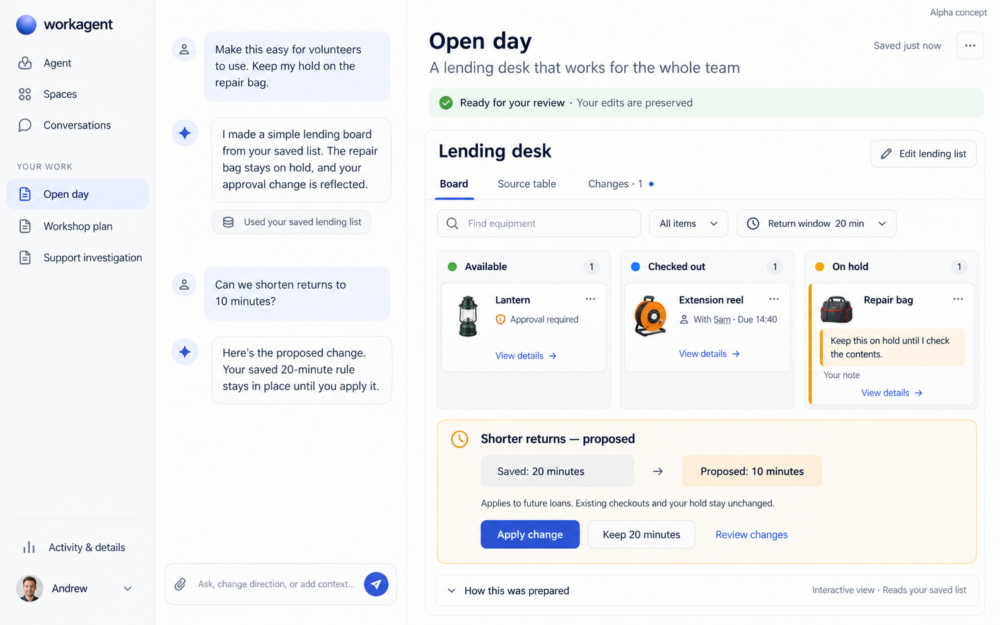
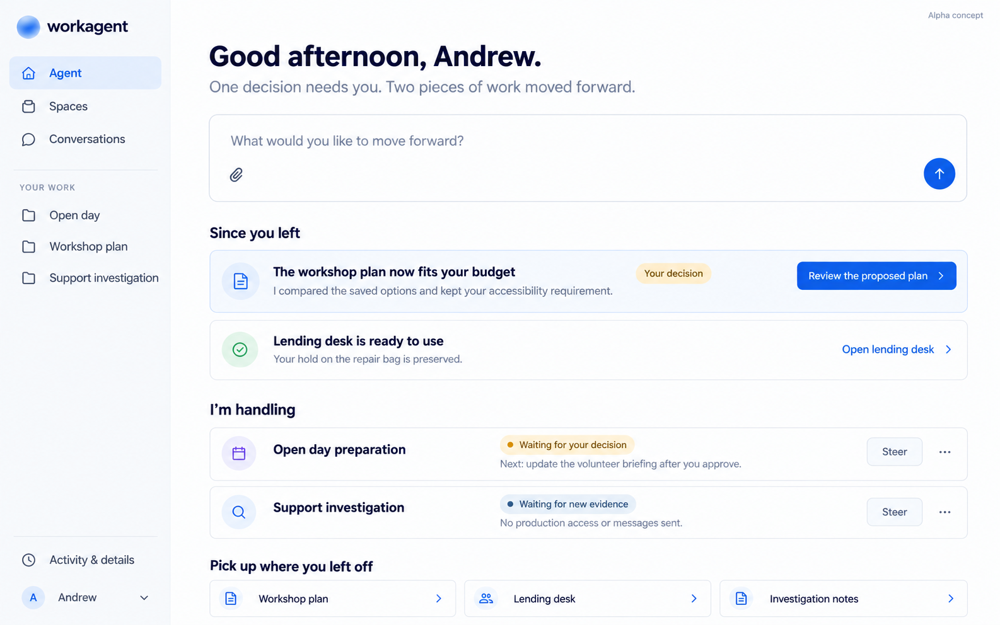
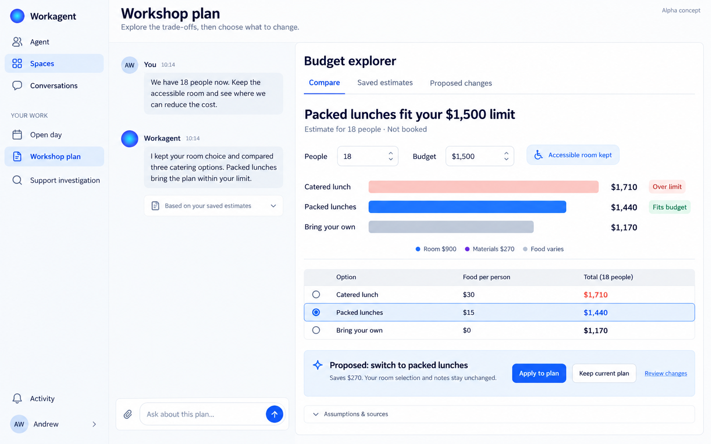
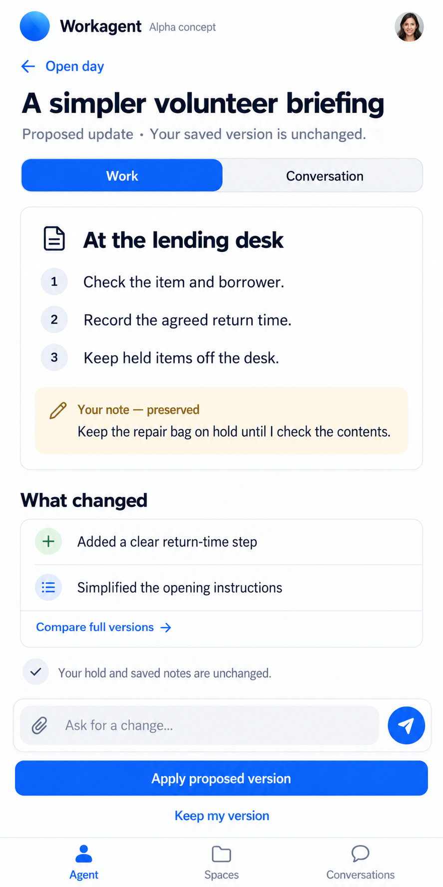
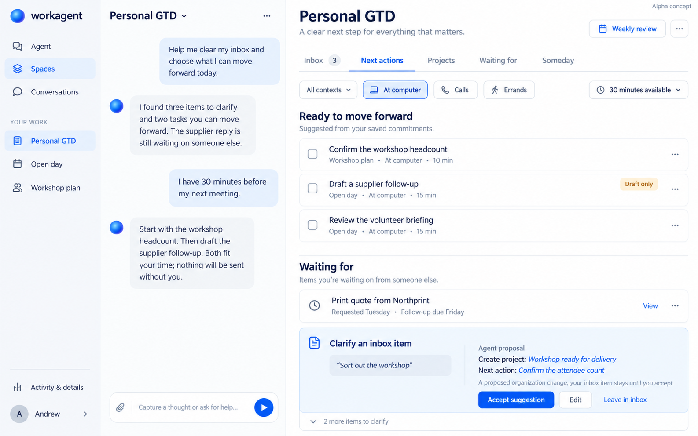

# Workagent alpha — intelligent UI concepts

Generated with Andrew on October 15, 2026. Andrew responded positively to these concepts and requested that all five images and their descriptions be published in the repository.

**These are generated design references, not screenshots of the running app, test evidence, feature acceptance or release approval.** They describe an intended alpha experience. Example names, people, figures and statuses are illustrative. The original image bytes are preserved; `manifest.json` records their hashes.

This gallery complements the [product contract](../../PRODUCT_CONTRACT.md), especially its adaptive, intelligent UI direction. [STATUS.md](../../../STATUS.md) remains the implementation checkpoint. The gallery was added above `e39f2af`; its pictures must not replace that checkpoint's failed/unknown outcomes with imagined successes.

## Shared direction

- A familiar shell surrounds a working area that adapts to the user's intent. Conversation and steering stay accessible.
- Lead with useful work, the result and the next meaningful decision. Keep diagnostics and repeated explanation in optional details.
- Temporary exploration, saved work and proposed changes have distinct meanings. Human contributions remain authoritative and recoverable.
- A board, calculator, comparison, document or ordinary answer can be appropriate. These examples are not workflow routes or a supported-task whitelist.
- Controls must connect to actual authorized operations on canonical work. Generated views do not acquire save, approval, messaging or other privileges because a mockup contains a button.
- Preserve readable density, keyboard access, focus, drafts and orientation across desktop/phone changes. Favor progressive disclosure over nested scrolling and walls of caveats.

## 1. Lending workspace — conversation alongside adaptable work

**Intent:** make a saved equipment list useful to volunteers, while preserving the user's hold on an item.

The working area becomes an easy-to-scan board with available, checked-out and held items. Conversation explains what changed, while the original source table and proposed changes remain accessible. A trusted edit control leads back to canonical data. The decision region compares the saved 20-minute rule with a proposed 10-minute rule before explicit acceptance.

**Behavior to carry forward:** keep the human hold visible; distinguish source editing from view filtering; show the exact consequence of applying a change; preserve saved state until acceptance. The view may be generated, but acceptance belongs to the trusted application shell.

**Evidence boundary:** the illustrated successful 10-minute proposal was a design target; the actual corresponding attempt was unresolved at the base checkpoint. Do not mark it delivered from this image. Checked-out items, names and times are illustrative, not connected inventory evidence.

## 2. Agent home — what changed and what needs me

**Intent:** let a returning user immediately understand the useful progress, pending decisions and responsibilities being handled.

A natural-language entry leads into “Since you left,” a focused review decision, truthful waiting states and links back to current work. “I'm handling” describes a next action or dependency rather than presenting a generic activity feed. Steering is available beside each responsibility.

**Behavior to carry forward:** populate this from canonical outcomes and responsibility state; suppress unchanged noise; make reopening the right result easy. A saved conversation alone must not appear as an actively owned responsibility.

**Copy refinement before implementation:** the headline “The workshop plan now fits your budget” should read “A proposed workshop plan fits your budget” while acceptance is pending. “Ready to use” needs actual capability evidence. Do not reproduce optimistic screenshot wording over incomplete work.

## 3. Adaptive planning — explore trade-offs, then commit

**Intent:** help a person decide between options with adjustable assumptions and a clear recommendation.

Conversation stays beside a budget explorer with editable headcount and budget, a preserved accessibility requirement, comparable costs and an explicit proposal. At the illustrated 18 people, room $900 plus materials $270 plus food yields $1,710 for $30 catering, $1,440 for $15 packed lunches, or $1,170 without provided food. Switching from catered to packed lunches saves $270.

**Behavior to carry forward:** controls explore a scenario without silently changing saved commitments. Explain which assumptions are preserved. Applying a proposal updates the same authoritative work used by conversation; it does not book a room or order food.

**Visual refinement before implementation:** the generated image's colored legend can imply stacked cost components, but its bars show totals. Use a simple total-cost label or correctly stacked components. The source of material-cost scaling must be explicit when headcount changes. These are sample data, not hardcoded product values or independently tested calculator output.

## 4. Phone review — a clear decision on a small screen

**Intent:** review useful work, see the human contribution and decide what to apply without scrolling through an execution transcript.

The phone view presents a short briefing, a preserved human note, concise change summary, access to the full comparison, natural-language steering and an explicit apply/keep decision. Work and conversation are reachable through a stable switch.

**Behavior to carry forward:** preserve both editing and conversation drafts across pane changes. Keep the proposed-versus-saved distinction clear. Sticky controls must not obscure content or the keyboard; verify actual phone widths, focus and screen-reader flow. The illustrated profile photo is a placeholder, not an identity requirement.

## 5. GTD workspace — an optional method in the same product

**Intent:** capture thoughts, clarify commitments and choose useful next actions by context and available time.

Inbox, next actions, projects, waiting-for and someday remain distinct. Conversation helps clarify an ambiguous note into an outcome and a concrete next action, with a reviewable organization change. Context and time filters help select suitable work. Weekly review is discoverable without dominating the workspace.

**Behavior to carry forward:** GTD is optional guidance and presentation, never the required route for all requests. A project represents an outcome; a next action is concrete; waiting-for represents a real dependency. Do not manufacture duplicate commitments in separate GTD storage. A draft follow-up is not an email sent, and a waiting-for entry does not imply an email integration.

**Consistency refinement before implementation:** the image proposes confirming the attendee count while a similar headcount action already appears above. Reconcile these into the existing action or explain the difference instead of creating a duplicate. The “two tasks” reply refers to the suggested 25-minute pair; label the remaining action as another option to avoid count ambiguity. Routine authorized organization need not require approval for every small change; use explicit decisions when the consequence warrants them.

## Owner handoff and scope

Claude remains the sole frontend owner. Use these images for hierarchy, density, interaction and responsive direction, not as a mandate to build five bespoke screens. Hermes owns runtime/domain/contracts, truthful outcomes and integration. Both owners should map visible controls to existing capabilities and identify gaps before claiming completion.

Extend the current application and existing shared work substrate. Keep ordinary answers simple, unfamiliar tasks possible, and generated presentations isolated. Do not restart the framework investigation or narrow the general-agent mission around lending, budgets or GTD. Current authorization and unresolved-attempt accounting remain unchanged.

This publication changes only design documentation and image assets. No application code, database, provider invocation, default-branch merge or deployment is part of it.

**Engineering:** image integrity and local Markdown links checked; no application tests required for this documentation-only addition. **Usefulness:** Andrew endorsed the visual concepts; operational usefulness remains to be demonstrated. **Experience:** design reference only, not a live usability or accessibility pass.
