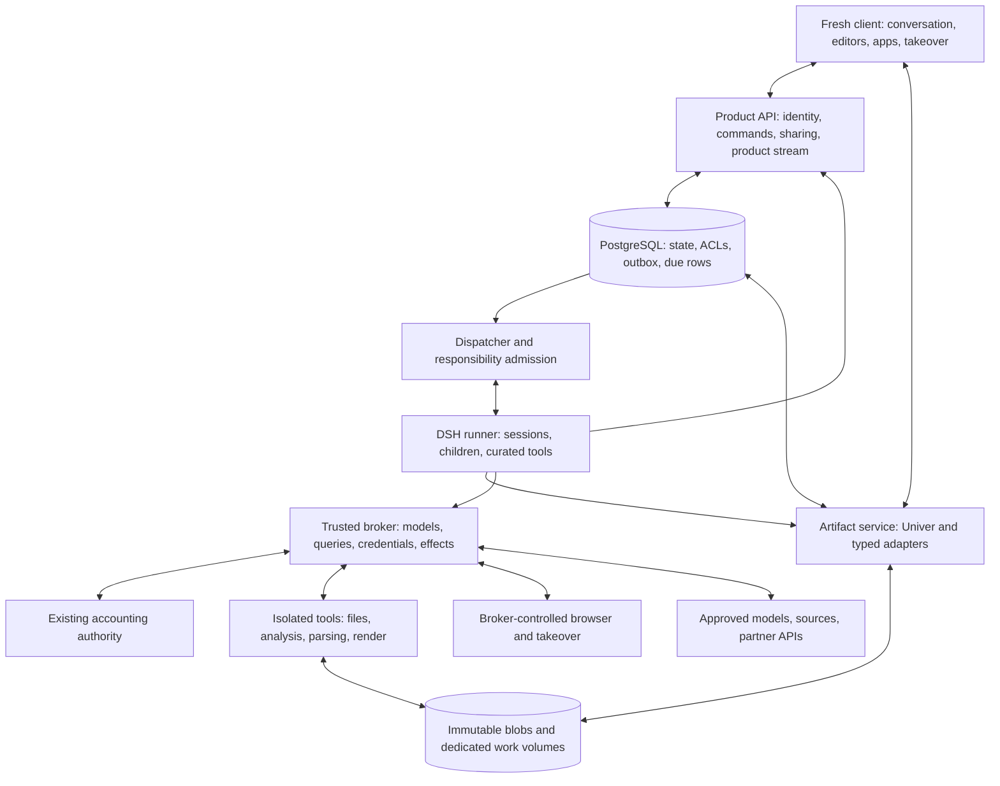

# Workagent architectural plan

**Version:** 1.1 · 12 November 2026 · canonical repository direction

**Status:** B01 is active under owner START; B02/B03 follow as prerequisites permit. Component qualification is distinct from completion; no procurement is activated.

**Goal:** Deliver the [product blueprint](01-product-blueprint.md) through one persistent agent workspace, native collaborative artifacts, and continuing responsibilities.

**Architecture:** DSH owns execution; Workagent owns product state, artifact meaning, permissions, and continuity. Mature editors own editing mechanics. Trusted services mediate credentials, spend, and consequential actions.

**Selected stack, subject to bounded qualification:** Node 24, TypeScript, React/Vite, pinned public DSH packages, PostgreSQL, Univer, isolated DuckDB, ECharts, MCP Apps, rootless OCI execution, existing Python accounting authority through an unproven minimal bridge. Speech/video components are qualification targets, not installed dependencies.

**Companions:** [Blueprint](01-product-blueprint.md) · [Build steps](03-build-steps.md) · [Development authority](../DEVELOPMENT_AUTHORITY.md) · [Model spending](../GENERAL_MODEL_AUTHORIZATION.md)

## 1. Baseline and design constraints

Source baseline: `0ceb9818eb5278b54c37b3cf72c1fec2a8325b1d`, containing `apps/dsh-slice/`, legacy `web/` and `backend/workagent/`. B01 source base is `bbd9631afd34fa915233f6f4f32428635b5dc6b4`; paths below are created as consumed. Create only paths with a real consumer or ownership/trust boundary, not all packages upfront.

The slice uses actual public DSH 0.2.2-rc.1 packages with scripted inference. Its execution and recovery checks are useful regressions, not proof of the proposed product. The old client and workshop remain separate. Pre-pivot application data is disposable with no migration requirement; no retained data is deleted in this run. Financial history remains authoritative and new work is protected. The last verified check found the old services stopped and disabled. Keep them stopped under current direction; this child performs no process check or service operation.

Current repository authority follows the owner's fresh rebuild budget under configured OpenRouter limits. The old $275 campaign and its ledger remain historical; transitional local certificates are not the new spending cap. Older first-use sequencing and UI designs are superseded by the owner's redirection. Safety, saved work, receipts, and actual authorization boundaries are not superseded.

## 2. Architectural decisions

### A01 — Reuse DSH, not its incidental UI

DSH owns model/tool iteration, native sessions, cancellation, child work, curated skills, compaction, and execution lifecycle. Workagent does not implement a second model/tool loop or a separate agent team coordinator.

Keep the verified rc1 fixture and use one coherent published **0.2.2-rc.1** set for
B01. No rc2 upgrade detour or prerelease mixing. Preserve native tool IDs, opaque replay
metadata, cancellation and accounting. OpenRouter is the inference route, default
`typesafe/jev-router` with explicit-model overrides for debugging/capability calls.
Retain opaque `session_id`, resolved response model and available routing metadata.
Jev include preferences are not hard allowlists; cost tiers are not monetary caps.
`typesafe/jev-1.14` is a separate structured Decisions API; no chat substitution or
silent direct-TypeSafe calls. Leave it disabled until its exact contract and accounting
are connected, with at most one bounded correction/intent seam in B01. No classifier
framework or probabilistic permissions. Disable unaccounted optional inference paths.


Disable feedback-triggered session sharing and DeepSeek log contribution explicitly. Do not route through the nanoMuse relay. Configure search deliberately rather than inheriting a new paid default.

### A02 — Fresh product client

Use React/TypeScript/Vite with a small accessible component system. Create the new client independently of both rejected component trees. Reuse backend contracts or proven pure utilities only after inspecting their semantics; copying the old UI under a new directory is not a rebuild.

Conversation stays available during work. Product events drive outcome updates; raw runtime events remain diagnostic inputs. No model request is triggered by merely selecting a cell or opening history.

### A03 — Native editing through one Office engine

Select Univer for Sheets, Docs, Slides, and Boards, subject to practical qualification and legitimate licensing. Use public Facade APIs and matching headless/editor/server versions. For collaboration, its authoritative collaboration service owns Office operation order and content revisions. B01 can use a private single-owner native editor with revision-checked durable snapshots, without claiming collaboration or OT. Agent operations and proposal acceptance must commit against the same snapshot authority.

Do not add a parallel Yjs/CRDT authority to the same content. Workagent adds provenance, human intent, change proposals, bindings, ACLs, and sharing—not another editor engine.

Public source does not mean every module is free. The November 12, 2026 license/pricing reference records free evaluation limits of **three editing connections (agents count), ten exports/month, watermarks and restricted modules**. Capacity/quota/license refusals are distinct from adapter bugs; diagnose them before rejecting the SDK and never evade the limits. Business was advertised at $99/month or from $1,000/year, separate from product model spending. Its recorded terms permit one collaboration-service instance and one conversion-service instance; multi-instance scaling, load balancing and automatic failover require Enterprise. Domainless/local deployment needs separately agreed scope. Per-owner VMs cannot assume one license covers every instance/domain/deployment. Verify entitlement for the actual intended topology before use beyond legitimate evaluation; no purchase is authorized here.

SDK gaps are explicit: PNG board export, ink capture, playable video, some annotations, semantic change review, accessibility/mobile interactions and cross-artifact lineage require Workagent integration. Bound the first qualification to one native sheet or document: create/edit/save/reopen, selection, protected agent changes and durable authoritative revisions. Reject or restrict the affected adapter if it cannot preserve content/permissions or enforce safe commits; retain uncommitted proposals where direct mutation is unsafe. Diagnose license limits separately. A failed module blocks its integration, not all useful work, and does not restart framework shopping or permit an HTML imitation of native editing.

### A04 — Product meaning in PostgreSQL, files in immutable storage

Use PostgreSQL for product state, ACLs, commands, outbox events, responsibilities, artifact metadata, source versions, and publication manifests. Store original uploads and exported results as immutable content-addressed blobs on a dedicated volume initially.

Avoid a graph database, distributed queue, Kubernetes, or object-storage cluster for the first owner deployment. Typed relationships and transactional due rows suffice. Keep a storage interface so relocation does not alter artifact identity.

### A05 — Authority outside the agent environment

The trusted broker controls model access/accounting, connector credentials, query execution authorization, and consequential effects. Untrusted tool code, document parsing, browsers, and generated apps never obtain the operator's ambient credentials.

App login, browser login, and connector consent are separate flows. App sessions do not authorize every external action. Browser possession does not prove semantic permission for a purchase or message.

### A06 — One accounting authority

The existing issuer and financial records remain the single spending authority. A narrow Python bridge is an **unproven seam to qualify in the first real-result unit**, not a drop-in library. Adapt only authorization, reservation, dispatch identity, usage/settlement and unresolved-liability handling needed by DSH. Do not invoke/import the legacy task-selection schemas, agent dispatcher, scheduler or runtime to obtain accounting. Do not create a second budget store or reset grants. Enabled model children, retries, compaction, auxiliary inference and JeV must use the same accounting path; disable unaccounted call paths. Preserve reported usage, uncertain liabilities and provider billing distinctions.

Inspect `responses_ledger.py`, `provider_attempts.py`, `responses_io.py` and recovery paths: they are coupled to legacy run/profile/schema semantics. Qualify the smallest DSH-compatible authorization/grant and usage envelope in disposable data without importing those execution semantics. Exact signatures and activation feasibility are unknown. If an installed schema/grant operation is necessary, prepare the safe change and report the precise authority needed; do not change installed accounting or route around it. Retain the certificate-backup and unchanged-alpha boundaries in development authority.

## 3. Components and boundaries



These are ownership boundaries, not a mandate for a microservice per box. Initially one Node product service can host product routes, scheduling, collaboration integration, and artifact orchestration. Keep the DSH runner and trusted broker as separate processes where isolation requires it. Start heavy tools lazily.

Candidate repository locations, created only as consumed (not prerequisite scaffolding):

- `apps/workagent-client/`: fresh shell, artifact screens, selection context, phone layouts, app views, takeover UI.
- `apps/workagent-server/`: authentication, product APIs/stream, persistence, sharing, responsibility admission, collaboration integration.
- `apps/workagent-runner/`: pinned DSH composition and dispatcher process entrypoint.
- `packages/workagent-domain/`: shared typed entities, commands, revisions, semantic events.
- `packages/workagent-artifacts/`: editor adapters, mutations, proposals, anchors, bindings, exports.
- `packages/workagent-app-host/`: MCP Apps protocol, view lifecycle, capability mediation, generated-app storage.
- `packages/workagent-broker/`: model, credential, query, connector, and effect contracts.
- `packages/workagent-dsh/`: public DSH adapters, intent steering, projection, recovery.
- `services/workagent-execution/`: isolated worker images/backends for parsing, browser, analysis, speech, and rendering.
- `backend/workagent/workspace_accounting_bridge.py`: minimal adapter location to qualify against existing accounting; no new ledger or legacy runtime activation.

## 4. Domain model and revision ownership

### Workspace and identity

`Workspace` owns membership, default presentation preferences, source grants, storage namespace, and budget references. `Principal` represents a human, agent work item, service, or bounded publication viewer. Child agents act under explicitly inherited constraints checked by the broker, not merely parent prompt instructions.

### Conversation, work, and intent

`Conversation` is the persistent interaction history. `Work` is an objective with an intent revision, outcome state, source context, cancellation epoch, and DSH session bindings. One conversation can contain multiple work items. Unrelated work has separate sources and authority unless the user links it.

An instruction changes intent. An artifact edit changes content. A comment is a comment unless explicitly addressed as an instruction. An ambiguous request to modify ongoing work receives a targeted clarification, not an arbitrary cross-task mutation.

### Artifact and contribution

`Artifact` has a stable ID/type/title, authoritative content locator, current content revision, permission references, source bindings, and display metadata. Office content is authoritative in confirmed Univer Units/changesets. Other artifacts use typed state behind the same registry.

`Contribution` records actor, base revision, typed operations, relevant read-set, source references, originating work/intent, and resulting revision. `ChangeProposal` retains pending agent changes and accept/reject/supersede status. Human and agent contributions are both visible.

Do not use one global version across schedule, intent, and content. Relevant revision checks are explicit: intent revision for steering, content revision for edits, grant version for access, source revision for bindings, and cancellation epoch for dispatch.

### Sources, queries, and bindings

`SourceVersion` identifies origin, retrieval time, retained blob/result, schema, and permission scope. `Dataset` names a usable source snapshot or query result. `QueryDefinition` stores normalized query identity, parameters, connection, principal, and execution limits. `MetricDefinition` adds human certification bound to query/schema/tests.

`Binding` records source and selector, target anchor, transformation, last-applied source revision, and policy: live value, maintained interpretation, or snapshot. `Publication` records the exact artifact/source revisions and allowed audience.

### Responsibilities and effects

`Responsibility` records purpose, permitted sources/actions, trigger, timezone/catch-up behavior, budget reference, notification policy, last observation, next check, and pause/end conditions.

`Command` is an admitted user or scheduled request. `Effect` is a stable logical external operation with grant, action digest, dispatch state, provider identity, and outcome/uncertainty. `Approval` binds the exact consequential action and scope; a natural-language research request is not blanket approval for side effects.

## 5. Proposed interfaces

These are product contracts to implement, not existing endpoints or DSH API declarations. Use runtime validation with shared types; do not trust client-supplied actors, principals, or grants.

```ts
// Proposed minimum boundary types, not SDK implementations.
type ArtifactKind =
  | 'sheet' | 'board' | 'document' | 'deck'
  | 'dashboard' | 'story' | 'video' | 'generated-app';

type SelectionRef = {
  artifactId: string;
  revision: string;
  anchors: string[];
};

type WorkCommand = {
  commandId: string;
  conversationId: string;
  workId?: string;
  kind: 'start' | 'steer' | 'cancel';
  text?: string;
  sourceIds: string[];
  selection?: SelectionRef;
  expectedIntentRevision?: number;
};

type ProductEvent = {
  eventId: string;
  entityId: string;
  entityRevision: string;
  kind: string;
  payload: unknown; // Validated by the semantic-event discriminant schema.
};
```

Minimum proposed routes:

- `POST /api/work/commands`: authenticate, validate target/source access, admit command and outbox atomically; return command/work identity and accepted revision. Repeating a command ID with identical input returns the original result; conflicting reuse is rejected.
- `GET /api/work/:id`: product snapshot including current outcome, artifacts, pending proposals, and intent revision.
- `GET /api/events?after=<eventId>`: authorized product replay/stream. If retained history no longer covers the cursor, return a snapshot-reset instruction. Do not project this argument onto DSH's raw follow API.
- `POST /api/artifacts/:id/changes`: typed, idempotent mutation/proposal submission, with base revision and read-set.
- `POST /api/artifacts/:id/proposals/:proposalId/decision`: accept/reject after fresh permissions and conflict validation.
- `POST /api/artifacts/:id/export`: create a bounded export job against a pinned revision; no implicit publication.
- `POST /api/responsibilities`: persist authorized scope and schedule/event definition.
- `POST /api/responsibilities/:id/pause`: prevent new occurrences and reconcile in-flight work honestly.
- `POST /api/browser/takeover`: obtain an exclusive short-lived lease; do not return provider credentials.

For multi-human collaboration, the native collaboration protocol remains separate; these routes do not replace OT. The initial single-owner B01 snapshot path is explicitly narrower and does not claim OT or collaborative convergence. Reject mismatches explicitly rather than coercing malformed identifiers into different resources.

## 6. Execution, durability, and recovery

### Command admission

1. Authenticate and resolve source/action grants.
2. In one transaction, create/deduplicate the command, advance the relevant intent revision, and insert an outbox record.
3. Dispatcher claims the record using database ownership/lease semantics.
4. Bind or recover the corresponding DSH session and stable request identity.
5. Submit through public DSH interfaces; perform the required public session flush when a durability barrier is necessary.
6. Project meaningful results into durable product events.

Dispatch is at least once. Do not claim exactly-once execution. An accepted prompt response is not proof that all work was durably persisted. If a crash leaves native-session creation ambiguous, inspect durable session bindings/history before creating another.

### Cancellation and stale work

Advance the cancellation epoch, block new dispatch, interrupt native execution, and reconcile in-flight effects. Show “cancellation requested,” “stopped,” and “an action may have happened” accurately. Every agent mutation must serialize its relevant read-set, intent, grant and cancellation preconditions with the authoritative content mutation commit, including any OT transformation. A separate preflight CAS followed by later editor submission leaves a race. If the authority cannot enforce those conditions, retain the changes as an uncommitted proposal; acceptance must validate them at commit too. Post-overwrite conflict detection is not protection. Stale work becomes a visible proposal or recomputation.

### Artifact durability

Every confirmed relevant content change must remain discoverable after a crash and be applied idempotently. Qualify one of two mechanisms against the authoritative editor:

- Prefer a content commit and propagation/outbox record in a shared transaction where the adapter supports it; prove rollback and crash recovery.
- Otherwise prove revision/snapshot catch-up: retained revisions cover the recovery window, durable snapshots recover gaps, and expired/missing cursors trigger an explicit gap/reset instead of skipping changes. Advance an ordered persistent cursor only after durable application; replay is idempotent by source/target revision. Retention, deletion/tombstones and permission revocation must have defined handling so catch-up neither resurrects deleted content nor retrieves revoked material. Revalidate scope on reads and application, invalidate dependent caches and expose lag/reset state.

Process-local callbacks can wake a poller, but are not durable events or proof of propagation. Do not invent vendor guarantees. If neither mechanism is proven, block automatic propagation/collaboration claims for that adapter; keep safe single-artifact work and proposals usable where supported. Test human-edit/agent-commit interleaving at the actual mutation authority, not just a comparison helper.

### Effects

Persist logical operation identity before dispatch. Use provider idempotency/status lookup when available. An ambiguous effect stays unknown and is not blindly resent. A changed action digest or intent invalidates an old approval. Receipts remain immutable even if the work is later cancelled or an artifact restored.

### Responsibilities

PostgreSQL due rows are canonical. Schedule occurrences and validated webhooks atomically create command/outbox entries. Deduplicate external event IDs and scheduled occurrences; coalesce missed periodic observations according to the recorded policy. Avoid competing DSH and product schedule authorities. Use DSH for execution after admission.

## 7. Collaboration and cross-artifact behavior

OT handles ordering; Workagent handles meaning. Agent changes carry the facts they read, stable anchors, and source revision references. Disjoint edits can rebase; changed inputs require recomputation; overlapping human decisions remain protected and generate visible proposals.

A manual override breaks automatic replacement of that target until relinked. It does not hide new source findings. Selection context includes the artifact revision, stable anchors, values/formulas or nearby structure, and source references. Resolve it when the user submits a request, not on every mouse movement.

Use native stable object IDs. When an editor uses positional references, transform product anchors through row/column/text operations. A row insertion must not move a citation to the wrong record.

Binding propagation is explicit and bounded. Reject unsupported cycles. Deterministic values update; narrative implications propose changes; snapshots remain pinned. Cross-artifact updates are not globally atomic. Expose partial/stale outputs and publish only a declared consistent manifest where coherence matters. Rendering and video jobs pin the same manifest to avoid mixing revisions.

## 8. Data, certification, and sharing

Analyze files in restricted DuckDB workers, with resource/time limits and unneeded filesystem/network/extension access disabled. Remote queries use source-native permissions and brokered credentials. SQL parsing is helpful validation, not the security boundary.

Each connector implements a common contract for capabilities, query execution, parameters, schema discovery, cancellation, result provenance, and revocation. Redshift, BigQuery, ClickHouse, Databricks, Snowflake, and Salesforce need separate real qualification. Do not pretend Salesforce is simply another SQL driver.

Dashboards use typed models and ECharts; stories use revision-bound data plus editorial blocks. Expose query, parameters, retrieval time, transformations, and source definitions. Provide accessible tables and descriptions.

Ordinary uncertified queries, charts and analysis remain usable. Applying a certified label requires a human capability. It binds query, parameter schema, source/schema assumptions, and tests. Editing the definition removes certification; relevant source changes can mark it stale. Imported dbt/Looker/Cube/Git definitions retain their original semantics and authority boundaries; import does not establish semantic equivalence or transfer certification authority.

Live sharing uses a bounded publication grant: query hashes, allowed parameters/columns, audience, expiry, and source policy version. Cache identity includes tenant and execution/publication authority as well as query identity. A viewer cannot convert a shared chart into arbitrary use of the creator's credentials. Revocation applies to retrieval, refresh, collaboration reads/submissions, app capabilities, and dependent caches. Previously downloaded files cannot be recalled.

## 9. Interactive apps and partner delivery

Implement a real MCP Apps host: discover `_meta.ui.resourceUri`, fetch UI resources, isolate rendering on a distinct origin, negotiate capabilities, and bridge the standard JSON-RPC messages with exact-origin/source validation. Support inline/panel/full-screen, direct opening, and synchronized pins.

`ui/update-model-context` supplies untrusted contextual data. It does not authorize actions or replace the user's instruction. View tools receive per-instance names, schemas, cancellation, and capability checks; they disappear when the view closes. Background work must use a durable server capability instead.

Full partner editors need partner-supported frame policy, authentication, and session exchange. Keep short-lived sign-in tokens out of model context. A connector token does not authenticate any arbitrary website. Human actions directly inside a partner editor remain governed by that partner; Workagent cannot claim universal interception.

Generated apps use restricted data/action capabilities and explicit personal/shared storage. Isolate their code and network origins; never expose server credentials or a general model proxy. “Send to” uses destination-specific mappings, exact action scope, idempotency where available, and retained external receipts. Failed or unsupported mappings remain visible.

## 10. Environment, authentication, and resource control

For authorized private remote use, require authenticated access and encrypted transport, with owner-controlled enrollment/session recovery. An established suitable authentication mechanism can support the first proof; a whole passkey product is not a prerequisite. Use dedicated product/runner/broker processes, the qualified accounting bridge, PostgreSQL and dedicated volumes as needed by the enabled path. A Workagent test server is an explicitly isolated product environment, never the operator Hermes host/profile. Use a disposable development database; do not reuse or reset installed databases. Parent owns private operation on the dedicated `workagent-dev` server at `10.0.14.244`; the child does not operate it. No public deployment is activated.

Introduce actual isolation with each enabled tool. The bounded B04 XLSX increment uses rootless bubblewrap namespaces, a read-only Python environment and parser file, private temporary storage, no network and process/resource limits; sandbox failure closes the path. This is a pragmatic namespace backend, not OCI packaging or the future execution fleet. Expand untrusted code and parsers into rootless OCI environments with no host socket, operator-home mount, ambient credentials or trusted database access. The whole final tool fleet and full browser takeover need not precede a file/editing result. Keep browser cookies/profile in a separate broker-controlled browser environment, inaccessible to shell tools. Treat local MCP code execution as untrusted too.

Sensitive takeover pauses agent observation and interaction, acquires an exclusive lease, and resumes only after explicit release. An interrupted takeover does not silently return control during login. Unsupported consequential website actions require human final submission until a reliable action integration exists.

The rc2 Office tool's in-host parser must not run untrusted documents inside the trusted runner. Use isolated conversions and validated artifact adoption. Apply the same principle to image/video/document parsers and generated code.

Before hosting unrelated users, use per-owner VM isolation and obtain licensing/procurement authority for the resulting service instances and domains. This is a future multi-owner requirement, not a global hold on a single-owner proof. Containers share a kernel and are not the same isolation claim. Read current host capacity before selecting concurrency/quotas. Serialize browser control per profile; run one heavy render/conversion job initially; suspend idle tools and queue work rather than revive the old stack or exhaust memory/disk.

Back up product metadata, Office state, DSH sessions, immutable blobs, permissions, and accounting references coherently. Test restoration against an isolated copy. Retaining raw files without their grants/revisions is not a complete restore.

## 11. Memory, methods, and bounded JeV

Store editable, scoped memory with source references and correction history; use Markdown representations plus a derived index initially. Separate explicit preferences from inferred ones. Retrieval checks scope and revocation. Forgetting stops use and updates derived indexes; do not promise erasure from immutable receipts or external provider records.

Curated skills load progressively. Candidate learned methods remain inspectable and cannot expand authority. Use bounded specialists only where they improve an outcome; preserve parent ownership and shared spending.

JeV can rank source-backed alternatives or advise notification timing. Its confidence is not proof. Urgent thresholds, refusals, and required approvals bypass the advisory step. Invalid/unavailable responses fall back deterministically. A real approved integration must be distinguished from the existing disabled/offline seam.

## 12. Files, media, and portability

Every import retains its original file, provenance, and conversion outcome. Exports pin artifact revisions and report fidelity losses. Do not equate “opens without error” with preservation of formulas, layout, charts, media, and comments.

Video is a scene model referencing chart/text revisions, narration, captions, timing, and assets. Qualify local Kokoro narration and isolated FFmpeg/rendering before adopting them. Language and asset licensing remain explicit. Voice input is a separate provider/engine decision; do not assume a TTS model supplies dictation.

Portable exports and source/binding manifests allow movement without copying credentials. Device access later uses a capability bridge for a chosen folder or action; never mount the operator's profile as product context.

## 13. Verification and failure policy

Test changed boundaries rather than constructing a new certification system. Required behavior includes duplicate admission, session recovery, effect ambiguity, stale proposals, anchor integrity, ACL revocation, cache isolation, source-triggered maintenance, and provider/accounting fidelity. Use ordinary component tests plus realistic browser journeys.

Use early code/fixture checks for actual risks, then the smallest authorized real-model path in the first editable-result unit; do not remain in a long fake-provider-only phase. Physical-phone use, two-human collaboration, real connector execution, file round-trips and partner embedding need evidence before those capabilities are declared ready. Their absence blocks those claims or dependencies, not independent work.

Use at most one independent risk-focused review when appropriate. No review cascades, broad study campaign, new evidence bureaucracy, or calendar estimates derived from source inspection. Preserve partial work and report genuine blockers promptly. Never route around a git, filesystem, database, or permission refusal.

## 14. Decisions still requiring qualification or authority

- Coherent DSH rc1 composition and real provider replay/cancellation/accounting fidelity; the minimal ledger seam remains unproven.
- Univer native editing, commit-time preconditions and durable shared-transaction or revision/snapshot propagation; collaboration/mobile quality and legitimate license capacity/procurement.
- Export fidelity and the exact supported formula/language baseline.
- Secure private remote access and recovery, without requiring passkeys specifically before useful proof.
- Connector accounts, partner APIs/embedding agreements, and approved data scope.
- Authorized JeV route and speech/video resources.
- Installed-data migration, external effects, public deployment, and broader hosting where separately gated.

A blocked partner integration must not stop unrelated native-workspace progress, but it remains incomplete scope. The architecture is not a guarantee that every external provider will grant access.

## 15. Primary technical references

- [Pinned DSH rc1](https://github.com/deepseek-ai/deepseek-harness/tree/66491b05e3f05ad35bcdd4f6cd7ed26041d9e3db) · [rc2 release](https://github.com/deepseek-ai/deepseek-harness/releases/tag/dsh-v0.2.2-rc.2)
- [Univer core pin](https://github.com/dream-num/univer/tree/5a06a7842c8e13fa0646d0733dc3662cf4b330b9) · [Boards](https://docs.univer.ai/guides/boards)
- [Collaboration ownership](https://docs.univer.ai/server/collaboration/overview) · [Authorization](https://docs.univer.ai/server/collaboration/identity-and-authorization) · [Database adapters](https://docs.univer.ai/server/collaboration/database-adapters)
- [Pinned PostgreSQL adapter](https://github.com/dream-num/univer-collaboration-sdk-community/blob/99b1d7b41d49449ffebcf5d56b7e286799e79810/packages/collaboration-database-postgres/src/postgres-database-adapter.ts)
- [MCP Apps](https://modelcontextprotocol.io/extensions/apps/overview) · [App tools](https://claude.com/docs/connectors/building/mcp-apps/app-tools) · [Embedded-site requirements](https://claude.com/docs/connectors/building/mcp-apps/embedded-sites)
- [JeV Choice](https://docs.typesafe.ai/primitives/choice)

These are source anchors retained from the November 12, 2026 research, not newly verified integrations. The accepted research/audits remain reference only. The blueprint retains the dated competitor scope and unknown formula/language catalogue completeness; the build steps schedule qualification without a new research campaign.
